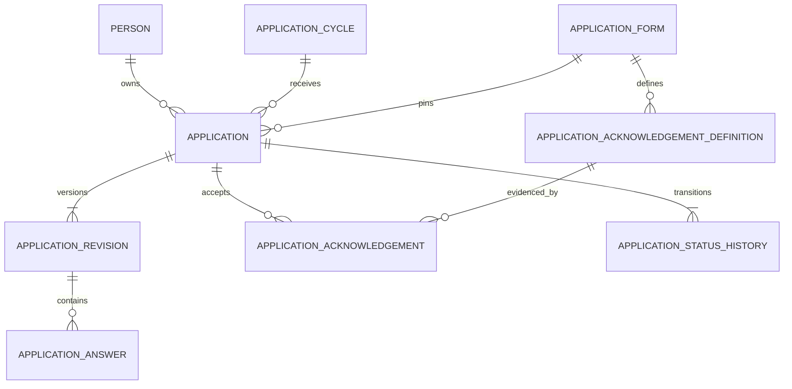

# Application submission design

Status: implemented in A01.4. Authority: master Sections 8, 19, 21, 26, 30, 36 and 37.

## Boundary and lifecycle

An application belongs to one Person, organization, published form version and application cycle. The cycle is the intake context and pins the form. A unique `(person_id, cycle_id)` constraint creates one application per person per cycle. Legacy form-only drafts remain readable but cannot submit.

The implemented lifecycle is `draft -> submitted`. Final submission requires an open cycle in its UTC window, the pinned cycle/form/organization tuple, the latest optimistic application version, every required answer, and acceptance of every required acknowledgement. Publishing a form requires at least one required `declaration` and one required `consent`. Documents remain outside this slice until A01.3 approves storage, scanning and retention.

Submission locks the application row and commits the accepted acknowledgement rows, application number, submitted timestamp, version increment, status history and audit row in one transaction. A retry carrying either the successful version or its immediately preceding version returns the existing receipt. A PostgreSQL sequence generates `EDP-{UTC year}-{8 digit sequence}`; the number contains no person data and is globally unique.

## Data model

Composite foreign keys keep the cycle, form, organization, acknowledgement definition and application evidence in the same scope. Database triggers freeze submitted applications, revisions, answers and acceptance evidence. Published acknowledgement definitions share the form-policy immutability boundary. Status history is append-only through a database trigger and version uniqueness.

## API and browser flow

Applicant endpoints remain under `/api/v1/applications/organizations/{organization}`:

- `GET /cycles` lists currently open application opportunities.
- `POST /cycles/{cycle}/draft` creates or resumes the owner's cycle draft.
- `GET /cycles/{cycle}/application` returns the owner's draft or submitted receipt.
- `PATCH /draft/{application}` saves a new immutable answer revision with `expected_version`.
- `POST /draft/{application}/submit` accepts `expected_version` and acknowledgement definition IDs.

The Next.js BFF uses a fixed UUID-shaped allowlist, browser session authorization, CSRF/origin checks for mutations, bounded JSON bodies and private no-store responses. The English/Tamil workspace covers cycle selection, draft/resume, required-answer validation, declaration and consent, explicit final confirmation, immutable receipt, timeline, conflict and error states.

## Security, privacy and operations

Applicant authorization is ownership plus organization scope; unknown and foreign applications return the same not-found boundary. Audit metadata records identifiers, action, request ID, resource version and allowlisted changed field names. It excludes answers and acknowledgement text. Consent evidence stores the immutable policy definition reference and acceptance time rather than a mutable boolean.

Apply migration `e6b7c8d9e0f1`. A schema downgrade is limited to disposable databases because the predecessor only permits draft applications; submitted evidence must never be silently rewritten or discarded in production. Operational rollback should leave the schema protections in place and disable new submission traffic. Retention and data-subject handling for submitted answers remain an owner approval gate before real-data use.