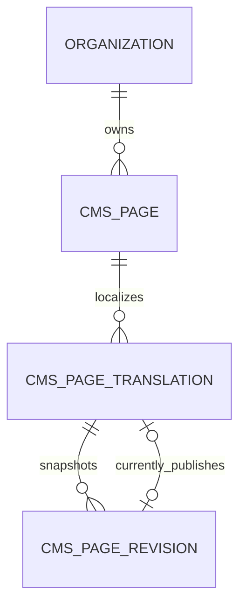

# CMS localized page design - C01.1

Status: proposed implementation design under the approved milestone plan; no CMS table or route exists yet. Modular monolith module `apps/api/app/modules/cms` owns pages and publishing. Identity owns authentication/organization grants/audit. Next.js owns staff authoring and public SSR; Flutter owns public discovery/rendering. Shared public DTOs contain no staff identity, draft, revision history or internal audit fields.

## PostgreSQL model

- `cms_pages`: UUID id, organization_id FK RESTRICT, normalized ASCII slug (1-120, lowercase letters/digits/hyphens), timestamps; UNIQUE(organization_id,slug), UNIQUE(id,organization_id). Slug immutable in C01.1; redirect-aware renames are a later design. No hard delete endpoint.
- `cms_page_translations`: UUID id, page_id, organization_id, locale CHECK en/ta, state CHECK draft/published/archived, version positive integer, draft_title (1-200), draft_body (plain text, at most 50,000 characters), draft_seo_title (at most 70), draft_seo_description (at most 200), published_revision_id nullable, timestamps. UNIQUE(page_id,locale); composite FK(page_id,organization_id) to page scope; UNIQUE(id,organization_id). Draft content is relational text, not arbitrary JSON or executable HTML.
- `cms_page_revisions`: UUID id, translation_id, organization_id, revision_number positive, title/body/SEO snapshot, published_at timestamptz, actor_user_id nullable FK RESTRICT; UNIQUE(translation_id,revision_number), UNIQUE(id,translation_id,organization_id), composite FK to translation. Snapshot rows immutable after insert, including through application endpoints. Database trigger rejects UPDATE/DELETE. Actor deletion is restricted while publication evidence exists; any future anonymization needs an explicitly reviewed retention migration.
- Translation composite FK(published_revision_id,id,organization_id) references revision(id,translation_id,organization_id), added after both tables exist. CHECK published requires non-null pointer; draft/archived requires null. This prevents cross-page/cross-org publication pointers. Authorizing staff can still retain all historic revisions. Page/translation/revision ownership deletes RESTRICT; no cascading evidence deletion.
- Index FK lookup paths plus public list `(organization_id,locale,state,page_id)` and staff list `(organization_id,updated_at,id)`. Migration reviews actual query plans before adding more. No migration for unrelated CMS entities in this slice.

## State, consistency and audit

Create page with its first locale draft atomically. Add second locale independently. Edit uses expected_version; service locks the translation, checks version and permission, updates draft fields/version and appends audit in one transaction. Editing a published translation leaves its live pointer and snapshot unchanged. Editing archived content is denied until explicit restore-to-draft.

Publish requires draft or published state, expected_version and valid fields. Under row lock, insert immutable next revision, switch pointer/state, increment version and append `cms.page.published` audit atomically. Archive clears pointer, sets archived and records required reason/version/audit. Restore-to-draft preserves draft/history, clears pointer and increments version. No generic writable status field. Concurrent stale mutations return 409; no automatic retries for editorial commands. A lost publish response is reconciled by reading state/version/history, not blindly repeating it.

Audit create/update/locale-add/preview/publish/archive/restore with actor, org, resource, request ID, version and changed field names; never copy page bodies or contact PII. Audit failure aborts writes. Preview is permissioned, no-store and noindex. Role revocation is checked on every operation using existing organization-scoped permission queries.

## RBAC and routes (planned contracts)

Explicit permissions: cms.page.view/create/update/publish/archive. Content Manager and Super Admin receive this implemented catalog through idempotent seed changes; other roles receive no CMS rights by default. View permits staff list/detail/history/preview; update permits draft editing and restore; publish and archive remain separate checks even when bundled in the initial role. Hidden UI actions do not replace backend checks.

| Method / route under /api/v1 | Contract |
|---|---|
| GET /cms/organizations/{org}/pages | Authorized bounded cursor list; filters allowlisted |
| POST /cms/organizations/{org}/pages | Create page/first locale draft; 201 |
| GET /cms/organizations/{org}/pages/{id} | Scoped staff detail; no cross-org disclosure |
| POST /cms/organizations/{org}/pages/{id}/translations | Add missing locale; uniqueness conflict 409 |
| PATCH /cms/organizations/{org}/pages/{id}/translations/{locale} | Allowlisted draft fields + expected_version |
| GET .../translations/{locale}/preview | View permission; no-store/noindex; audit |
| GET .../translations/{locale}/revisions | Authorized bounded immutable history |
| POST .../translations/{locale}/publish, /archive, /restore | Explicit versioned transition commands; archive reason |
| GET /public/organizations/{org}/pages?locale=en | Published-only bounded list |
| GET /public/organizations/{org}/pages/{slug}?locale=en | Published immutable snapshot only; 404 if unavailable |

Errors, request IDs and pagination follow existing API conventions. Invalid locale is 422; inaccessible staff objects are 404 after organization permission check (403 if no org permission). Public requests never accept draft/status/include flags. Public Next/Flutter organization binding is deployment configuration, not an untrusted Host-header lookup. Organizations have no public metadata endpoint in this slice.

Browser staff requests use the existing authenticated BFF trust boundary with fixed CMS route/method allowlists, server-only BFF key, CSRF and Origin protection. Raise body limit only for validated CMS editing routes (256 KiB); keep auth cap unchanged. Enforce API/proxy limits too. UTF-8 byte size and Pydantic character limits are distinct and both tested. Do not create a general-purpose upstream proxy.

## Rendering, localization and caching

C01.1 body is plain text rendered as escaped paragraphs in both clients; raw HTML/JavaScript is never executed. Rich content later requires typed allowlisted blocks/sanitization and a revised renderer/test contract. English/Tamil publish independently; missing locale has a localized unavailable state, not unpublished content or silent cross-language fallback. Stable shared slug avoids accidental locale namespace collisions.

Public responses use revision-derived ETag and `Cache-Control: public, max-age=0, must-revalidate`. Resolve current published state before evaluating If-None-Match; an archived page returns 404, never stale 304. Unavailable responses and all staff/preview responses are no-store. Next public fetches revalidate on each request for this first slice. This permits conditional caching without Redis invalidation races; TTL caches can be added with a tested invalidation design later. Public route /{locale}/pages/{slug}; draft preview under authenticated admin only.

SEO title/description come from the published snapshot; canonical URL is derived from configured public origin + locale/slug, never arbitrary user URL. Emit language alternates only for published counterparts. No draft metadata in sitemap, page source or mobile DTO. Full navigation/sitemap coverage belongs to C01.6.

## Verification and rollback

Test duplicate slugs/locales, pointer integrity, immutable revisions, XSS strings, size limits, publish races, stale edits, independent locales, wrong-org IDs, permission revocation, audit rollback, missing/archived public access, conditional requests and draft edits leaving live content unchanged. Assert BFF and Flutter parse actual public contracts. Use synthetic English/Tamil copy.

Migration downgrade drops CMS triggers and cyclic FK first, then revisions/translations/pages in dependency order. Destructive downgrade only on disposable test DBs. Deployment rollback prefers reverting code while retaining tables; published content requires backup/export and an approved disposal plan before schema removal. No migration or production data change is made by this design document.
