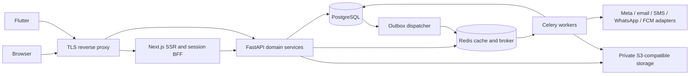

# System architecture

Status: proposed design baseline, internally reviewed before bootstrap; not production approval. Master Sections 3–5,23–29,32,38. See ADRs and ERD.

```text
apps/api/app/{core,common,modules,workers}  FastAPI modular monolith
apps/api/{migrations,tests}               Alembic and backend tests
apps/web                                Next.js public/authenticated/admin
apps/mobile                             Flutter feature-first client
packages/{api-contracts,design-tokens}    generated contracts and shared tokens
infra/{docker,nginx,monitoring,deployment}
docs/{architecture,database,api,security,testing,deployment,sdlc,...}
scripts/  .github/workflows/  docker-compose.yml  .env.example
```



## Module ownership

| Boundary | Owns | Collaborates through |
|---|---|---|
| identity/users/organizations | Accounts, people, memberships, sessions, scopes, centers | Auth dependencies and person IDs |
| cms | Localized public content and publication | Media service; publication events |
| crm/integrations | Leads/attribution/assignments; verified provider inbox | Person-link service; application conversion event |
| applications/selection | Versioned submissions, reviews, rubrics, decisions | Enrollment command after selected transition |
| programs/participants | Programs, cohorts, sessions, enrollment and participant lifecycle | Enrollment events; scoped query services |
| lms/attendance/assessments/certificates | Learning, presence, grades and completion evidence | Eligibility service; issuance event |
| mentors/business_plans | Assignment, private notes, actions; P1 plans | Participant scope and reminders |
| schemes/funding/opportunities | Published knowledge and participant cases | Bookmarks; funding transitions |
| businesses/impact/reports | P1 profile/snapshots; P0 indicators/outcomes; read projections | Authorized aggregates, no arbitrary cross-module writes |
| support/communications | Tickets; consent/templates/delivery | Transactional events and adapters |
| system | Settings, audit access, integration health | Explicit admin permissions |

Each module has models, schemas, repository, services, routes, permissions and tests as needed. Routes validate/authorize; services own transactions/state transitions; repositories access data. Cross-module writes use service commands, not another module's repository. Shared infrastructure is not a business-logic dumping ground.

## Identity and authorization

Person is the stable profile; User is an optional login linked one-to-one. A pre-registration lead can have a person without a User. Participant profile references person; enrollment references cohort and selected application. Never auto-merge people solely from unverified shared phone/email. Explicit linking/merge requires evidence and audit. Roles grant permissions through scoped assignments (organization/program/center/self/assigned). Participant lifecycle does not itself grant privileged permissions. See security model.

## Lifecycles

Services enforce allowed transitions with a row version, transaction and immutable history. Applications: draft→submitted→under review→shortlisted→interview scheduled→selected/waitlisted/rejected; only selected→enrolled. Controlled reopen creates a new editable revision with a reason; reviewed version stays frozen. Lead: new→contacted→interested→registration started→application submitted→qualified/not qualified; converted requires a linked applicant and authorized qualifying decision. Ticket: open→assigned→in progress→waiting for user→resolved→closed; controlled reopen records actor/reason. Funding: interested→eligibility check→document preparation→applied→under review→approved/rejected; only approved→disbursed. Final branching/skip/reconsideration policies need product confirmation; no permissive generic status PATCH.

## Integrations and notification delivery

Accept provider callbacks only after verification; persist unique inbox event then acknowledge. Store necessary metadata, not unrestricted payload logs. Same DB transaction commits domain change, audit and outbox. Dispatcher enqueues durable IDs; workers claim with locks, apply unique dedupe keys and record attempts. Backoff with jitter, maximum attempts and failure queue/administrative replay. Database outbox permits recovery after Redis loss. Exactly-once provider delivery cannot be promised; ambiguous timeout needs provider lookup/idempotency or operator review. Celery beat has a single scheduler; avoid duplicate scheduled dispatch.

Provider interfaces expose capabilities explicitly; dev transport is a no-delivery stub. Consent/channel preference and locale resolved at dispatch, with approved transactional exceptions. Version templates and consent decisions. Do not store tokens in IntegrationConfig: store secret references. Signed media links require fresh object authorization. AI adapters remain future and disabled.

## Environments and operations

Local Compose: PostgreSQL 17, Redis 7, migration one-shot, API, worker and Next.js; Flutter runs on host/device. S3 introduced with first upload slice. Test/CI isolated disposable DB. Staging and production separate credentials/data, TLS edge, private DB/Redis, non-root containers, migration release job, S3 private buckets, log/error monitoring and tested backups. Start with one PostgreSQL cluster/Redis and scalable stateless API/workers. No Kubernetes, Kafka, search cluster or separate microservices.

Redis is not the record of delivery or business state. Readiness checks DB and Redis with bounded timeout; worker health is separate. Public probes expose only status. Monitor outbox age, job failures, provider health, database/Redis errors and request latency. No raw personal data in telemetry.

## Risks and review

Budget and broad P0: deliver ordered vertical slices and protect quality gates. Privacy/retention and RPO/RTO are unresolved production blockers. Meta/WhatsApp approval can delay real integration; sandbox contracts first. SMS/email/video recurring charges need separate approval. Shared contacts create identity-link risks. Flutter SDK/Docker availability limits local proof. Client translations/content and UAT owners not supplied.

Consistency review: backlog IDs map requirements; ERD distinguishes person/account/enrollment; RBAC checks object scope; SQL transactions align audit/outbox; P1 profiles not required for minimal P0 impact; foundation authentication and organization permissions now have local client/server verification; see ADR 0003 and foundation-auth-report.md for remaining CI/device gates. No non-identity business schema or permissive auth stubs introduced.

References consulted: [FastAPI Docker deployment](https://fastapi.tiangolo.com/deployment/docker/), [Next.js installation](https://nextjs.org/docs/app/getting-started/installation), [Flutter installation](https://docs.flutter.dev/install). Dependency locks determine actual bootstrap versions; no claim of production hardening from framework defaults.
