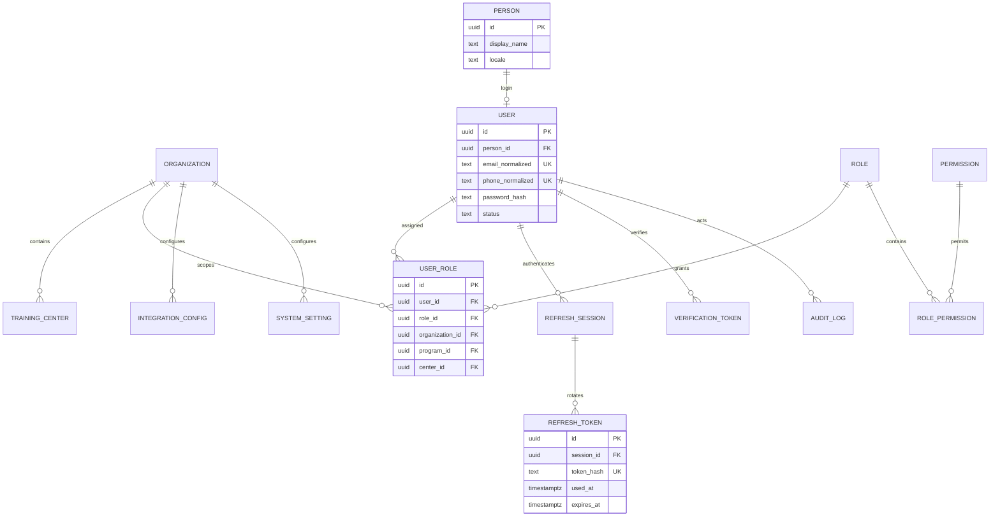
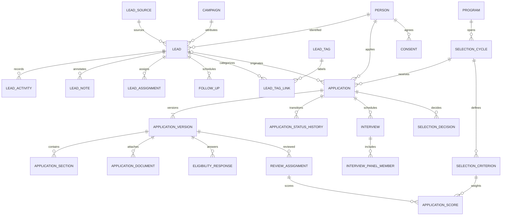
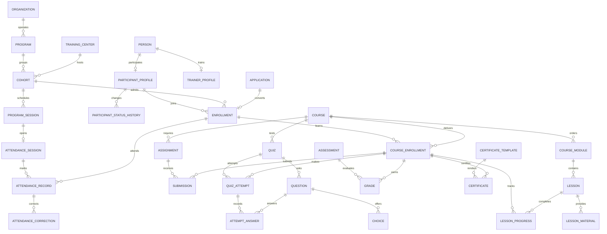
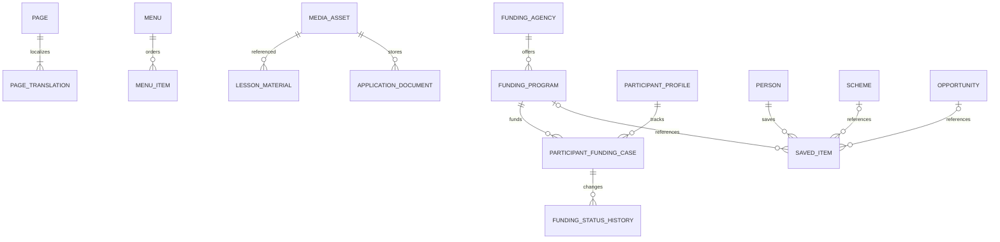
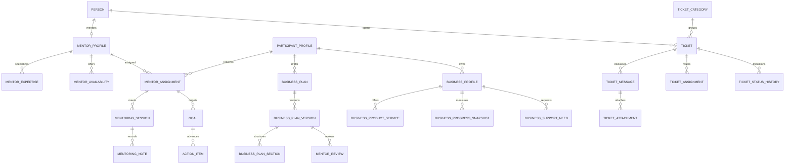
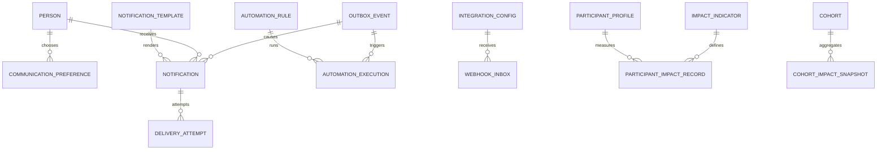

# PostgreSQL logical ERD

Logical target design plus implemented foundation subset. Revision 0001_bootstrap is schema-neutral; revision 1de5e104c2f7 implements people, users, organizations, roles, permissions, role_permissions, user_roles, refresh_sessions, refresh_tokens, verification_tokens, auth_deliveries, auth_throttles and audit_logs. Other domain tables remain unimplemented. UUID PKs unless noted; `created_at/updated_at timestamptz` in UTC; `created_by/updated_by` where justified. `version int NOT NULL DEFAULT 1` on editable workflows. Financial amounts use numeric plus currency, never floats. Statuses constrained and changed through services. All FK columns indexed unless already the leading column of a suitable index.

## Identity and organization

Person is the master user profile (maps UserProfile in Section 36); optional PersonContact stores normalized, verification-stamped contacts without duplicating profile across lifecycle tables. User requires at least one login identifier; unique partial indexes on non-null normalized email/phone. Shared prospect contacts may be candidate duplicates; no auto-merge. User.person_id unique. Role key and Permission.code unique; role_permission(role_id,permission_id) PK. Scoped user_role uniqueness uses PostgreSQL NULLS NOT DISTINCT across user/role/org/program/center; services and composite scope FKs ensure program/center belong to org. RefreshSession stores family/device/revoked_at/absolute expiry; each RefreshToken is single-use hash, linked replacement and expiry. VerificationToken purpose/hash/expiry/consumed_at; hash unique. Audit actor may be null for system; preserve actor pseudonym when account anonymized. IntegrationConfig holds references, not secrets. Settings unique(org,key), typed validated value.

## Acquisition, application and selection

Lead has source/campaign/adset/ad/form IDs/names, UTMs, landing/referral and received_at; provider+meta_lead_id unique when present. Person FK optional until identity resolved. Contact candidates indexed, not globally unique in CRM. Application unique(person,cycle), application_number unique, optional source_lead_id, current_version_id and version. ApplicationVersion unique(application,revision); typed relational ApplicationSection values (definition/version, typed text/number/date/choice), not arbitrary JSON blobs. Submitted revisions immutable; documents reference MediaAsset. Rubric criteria versioned/frozen once scoring starts; positive weights and valid score range. Unique(review_assignment,criterion), unique(application_version,reviewer) and unique(interview,user) panel. Decisions/history append-only with actor/reason/from/to/time. Concurrent finalization uses row locking and version check. Consent captures policy version, purpose, timestamp and withdrawal, never a bare boolean only.

## Programs and learning

Enrollment unique(participant,cohort) and application_id unique. Only selected application can create enrollment, participant link, audit and outbox in one transaction. ProgramCalendar is a projection of ProgramSession, not duplicate schedule data. CourseEnrollment unique(enrollment,course). CourseProgress is a derived projection from progress/assessment rules. LessonProgress unique(course_enrollment,lesson); module/lesson ordering unique(parent,position). Attempts unique(quiz,course_enrollment,attempt_number); answers preserve graded question version. Assignment submissions versioned unique(assignment,course_enrollment,revision). Grade unique(assessment,course_enrollment,revision); immutable finalized grades. Certificate verification identifier unique; issuance unique(course_enrollment,template,rule_version) with revoked_at. Attendance unique(session,enrollment); nonce hash unique, expiry/window enforced server-side. Corrections append reason/actor/previous/new status. TrainerSession and CohortCourse joins model many-to-many assignments explicitly.

## Content and knowledge

PageTranslation unique(page,locale) and unique(org,locale,slug). NewsArticle/Event/FAQ/Testimonial/Banner/Resource have localized child rows using same pattern; no JSON for translations. CMS status, publication timestamp, SEO title/description/canonical; public queries index(status,published_at). MenuItem self-parent FK validated for cycles. MediaAsset storage key unique, private visibility default, MIME/size/hash/scan status/owner recorded. ContactSubmission private and throttled. Schemes/funding/opportunities include official source, last_verified_at, opening/closing dates and visibility; relational tags/geography joins. SavedItem has exactly one non-null scheme/funding_program/opportunity FK (CHECK num_nonnulls=1), partial unique(person,target) per type; avoid unvalidated polymorphic ID. Funding case history append-only; service prohibits rejected→disbursed.

## Mentoring, business and support

MentorAssignment includes program and validity dates; unique active participant/mentor/program relationship via partial index. Note has constrained visibility (staff_private/shared_with_participant); query/DTO enforce. Business plan/profile tables P1; section keys/revisions unique, snapshot unique(business,period_end,revision). Revenue bands preferred. Ticket number unique; message internal flag never returned in participant DTO; attachments reference MediaAsset; ticket history append-only, index(assignee,status,updated_at). SLA policy stored as configuration once agreed.

## Communications, reliability and impact

Notification unique(event,recipient,channel,template_version); DeliveryAttempt unique(notification,attempt_number), optional provider ID indexed. CommunicationLog references delivery record rather than duplicating recipient/payload. Preference unique(person,purpose,channel). AutomationExecution unique(rule_version,event). WebhookInbox unique(provider,event_id). Outbox stores event type/entity ID, minimal versioned payload JSONB, attempts/next_attempt/dispatched_at; partial pending index(next_attempt,id). JSONB limited to validated dynamic integration metadata/settings/event payload. IdempotencyRecord unique(actor,operation,key) with request digest and result reference. ImpactIndicator version/unit/definition; impact record unique(participant,indicator_version,period,revision), includes source/evidence and approved fields. Minimal business-started/active/jobs-created outcome records do not require P1 BusinessProfile. Cohort snapshots record numerator/denominator/filter/version and period for reproducibility.

## Referential integrity, lifecycle and retention

| Entity group | Delete behavior / archive | Retention |
|---|---|---|
| Person/User/Organization/Program/Cohort | RESTRICT business FKs; archive; controlled anonymization service | Approved policy pending |
| Roles/permissions/bindings | RESTRICT roles in use; explicit binding revocation; join cleanup allowed | Preserve audit of changes |
| Sessions/tokens | RESTRICT parent while active; explicit expiry purge | Security retention configurable, approval pending |
| Applications/selection/enrollment/grades/certificates | RESTRICT parent deletion; immutable submitted/finalized history; revoke/archive | Program/decision retention pending |
| CMS translations/menu/tag joins | CASCADE only owned non-evidence children on authorized hard delete; archive published content | Content policy pending |
| Media/documents | RESTRICT referenced assets; lifecycle job removes object after approved record disposal | Document-specific policy pending |
| Mentoring/tickets/business/impact | RESTRICT evidence; archive; selective anonymization | Approved policy pending |
| Audit/status history/delivery evidence | Append-only; no parent cascade; actor SET NULL only with pseudonymized reference | Independent approved security schedule |
| Outbox/inbox/idempotency | Explicit retention cleanup after dedupe/replay window | Integration policy must precede ingestion |

Index high-use lists `(program_id,status,created_at,id)`, `(cohort_id,status,id)`, assigned-owner/status/time and timeline `(entity_id,created_at,id)` as applicable. Use EXPLAIN with realistic data before extra indexes. No uncontrolled cascade from person deletion. Unknown retention means no production data ingestion, not invented duration. Schema-level scope consistency (composite FKs), check constraints, partial unique indexes and concurrency tests are part of each future migration acceptance.

## Foundation implementation refinements

ADR 0003: email-only login initially (master allows email and/or mobile); Person holds name/locale, User holds unique normalized login email. UserRole grants exact organization scope only. RefreshSession stores mutually exclusive channel-specific browser/CSRF or access-token hashes, maximum expiry and revocation; refresh token rows retained for replay detection. AuthDelivery holds Fernet-encrypted development message payload tied to challenge; production delivery disabled. Throttle keys hash identifier + operation + fixed time window; atomic PostgreSQL upsert. Audit mutation trigger is installed/dropped by migration. Never use metadata.create_all for deployed schema changes.

## CMS first-slice refinement

The planned page/translation/immutable-revision model, scope-preserving composite foreign keys, constraints and indexes are specified in [CMS page design](../architecture/cms-page-design.md). No CMS tables are implemented yet; add only this subset with C01.1.

C01.1 implementation: migration 2b3fcc875606 now creates cms_pages, cms_page_translations and cms_page_revisions, plus nullable AuditLog resource_version/reason/changed_fields. Publication timestamp is Revision.created_at. Revision numbers follow the translation version at publication (gaps are intentional after edits). Staff pagination uses stable UUID cursors; translations are batched to avoid N+1 reads.

## C03 Meta lead inbox implementation

Migration c5d6e7f8091a adds meta_integrations, meta_form_mappings, and meta_webhook_events. An integration belongs to one organization and page; access tokens and app secrets are Fernet ciphertext, while verification tokens are one-way hashes. A form mapping belongs to the same organization in service policy and maps a bounded provider-field allowlist to name, email, and phone. The event inbox is unique by (integration_id, provider_event_id), records only troubleshooting identifiers rather than fetched lead PII, links the resulting CRM lead, and indexes organization/state/time for operational queues. Event expiry is calculated only from a deployment-configured, approved retention period; ingestion refuses to start when that policy is absent.

C03.3 enforces the existing `meta_webhook_events.retention_expires_at` index through a bounded scheduled delete. Audit logs keep only allowlisted disposal metadata and do not foreign-key the deleted event. The referenced CRM lead survives; its lifecycle follows the separate CRM retention decision. No schema migration was required.

## N01.1 in-app assignment notification tables

Migration f8a0b1c2d3e4 adds notification_preferences and notification_intents. Each preference belongs to one organization and user, is unique by (organization_id, user_id, topic), and has an optimistic version. Each intent belongs to one organization and recipient and references a CRM lead. Its unique (organization_id, recipient_user_id, event_key) key deduplicates a lead assignment version; state is pending, delivered or suppressed. Indexes support bounded pending dispatch and recipient inbox reads. The service verifies organization scope, recipient identity and current grant because these cannot be established by the individual foreign keys alone. Both tables retain identifiers and timestamps, not rendered lead details. The notification and audit retention policy remains unapproved.

N01.2 adds ix_notification_retention(created_at,id) to notification_intents for bounded cleanup. Expiry is derived from created_at and deployment-approved NOTIFICATION_RETENTION_DAYS, so tightening the period immediately hides and schedules disposal of older intents. Audit records have no foreign key to a disposed intent; lead and preference foreign keys remain untouched.

N01.3 adds nullable notification_intents.source_activity_id referencing crm_lead_activities, constrained to be present only for followup_due and absent for lead_assignment. A unique (source_activity_id,recipient_user_id) pair guards concurrent reminder creation. The due activity index supports bounded scheduling. CRM activity.reminder_queued_for_user_id is a durable last-recipient marker retained under the CRM activity lifecycle, preventing notification expiry from restarting reminders for an unchanged assignee. This marker is not message content.

Migration c4f5a6b7c8d9 adds the application definition edit revision, publisher reference, one-draft-per-organization partial uniqueness and database triggers that freeze published/retired titles and fields. Publication retires the previous live version; applicant revisions retain their original form foreign key.

## P01.1 implementation note

Migration d5a6b7c8d9e0 implements Program, TrainingCenter, Cohort and ApplicationCycle. Their composite organization keys and the cycle cohort/program key enforce the planned tenant boundary in PostgreSQL. ProgramSession, Participant and Enrollment were subsequently implemented by P01.2 without duplicating Person.

## A01.4 implemented application evidence

Migration `e6b7c8d9e0f1` binds Application to ApplicationCycle with a composite cycle/form/organization foreign key, changes uniqueness to `(person_id, cycle_id)`, and adds unique application number and submitted timestamp evidence. ApplicationAcknowledgementDefinition is an ordered child of the immutable form policy. ApplicationAcknowledgement references both the application/form and definition/form tuples and records `accepted_at`. ApplicationStatusHistory is unique by application/version. Database triggers reject mutation of submitted applications, their revisions/answers, acceptance rows and status history. The conceptual ApplicationVersion/ApplicationSection names above correspond to implemented ApplicationRevision/ApplicationAnswer tables. Documents remain conceptual pending A01.3.

## A02.1 implemented selection foundation

Migration f0a1b2c3d4e5 implements SelectionCycle, SelectionRubric, SelectionCriterion and ReviewAssignment. Composite foreign keys enforce organization scope from the application cycle through rubric and assignment, and from assignment to Application. Partial unique indexes constrain one draft and one published rubric per selection cycle; assignment uniqueness is (application_id, reviewer_user_id). PostgreSQL checks enforce lifecycle values, positive weights, bounded score ranges, criterion order and conflict-note consistency. Triggers freeze published/retired rubrics and criteria. Application and ApplicationStatusHistory now include under_review; the submitted-evidence trigger permits only the audited submitted-to-under_review state/version transition and preserves every submitted evidence field.
## A02.2 review scoring evidence

Migration `a1b2c3d4e5f6` adds ApplicationScore as one row per ReviewAssignment and pinned SelectionCriterion. Composite foreign keys require the assignment and criterion to share the same SelectionRubric. ReviewAssignment now records the internal comment, server-calculated weighted score, submission time and reasoned moderation state. Completion checks require score and timestamp evidence. PostgreSQL triggers reject changes to submitted scores, comments, reviewer, rubric, application and completion evidence; moderation fields remain independently versioned. Aggregates are derived views over included completed assignments and are not stored.

## A02.3 interview and decision evidence

Migration `b2c3d4e5f6a7` implements Interview, InterviewPanelMember and SelectionDecision. Interview is unique per application and scoped to the same organization as its SelectionCycle and Application. Panel membership is unique per interview/user; bounded score and submission checks keep draft and submitted states coherent. SelectionDecision is append-only and unique per application version, preserving actor, from/to state, reason, override flag and review/interview score snapshots. Application and status history now cover shortlisted, interview_scheduled, selected, waitlisted and rejected. PostgreSQL triggers preserve submitted application content while allowing only the documented state/version transitions, and reject changes to submitted panel scores, completed interviews and decision history.
## P01.2 participant and program-delivery evidence

Migration `5c48c1c3e88b` implements Participant as an organization/person projection, Enrollment as the unique application and participant/cohort membership, ProgramSession as the cohort schedule source, append-only ParticipantStatusHistory and minimal-ID DomainOutbox. Composite foreign keys bind every record to the same organization, program and cohort. Application now permits only selected-to-enrolled as the conversion transition. ProgramCalendar is derived from ProgramSession.

## P01.3 scoped staff-assignment evidence

Migration 6d59d2d4f99c implements ProgramStaffAssignment as an organization/user/center binding with optional cohort scope, state, optimistic version and revoked timestamp. A composite (cohort_id, center_id, organization_id) foreign key prevents mismatched scope. Partial unique indexes permit only one active binding for a user at a center or cohort while retaining revoked history. A PostgreSQL trigger freezes user and scope identifiers and accepts only the versioned active-to-revoked transition.

### L01.1 physical implementation

Migration 7e6ae3e5a10d implements Course, CourseModule, Lesson, LessonMaterial, CohortCourse and CourseEnrollment. Composite foreign keys carry organization and parent identity through the hierarchy. Unique constraints enforce module, lesson, material and cohort-course order. LessonMaterial is private-only and stores a provider key that is excluded from learner DTOs. PostgreSQL triggers reject structural mutation after course publication. CourseEnrollment is unique by source Enrollment and Course; progress and completion evidence remain later L01 slices.

## L01.2 learning progress extension

- courses 1--many lessons; courses carry a frozen all_lessons or minimum_lessons completion rule.
- lessons 1--many lesson_prerequisites as target and prerequisite; both composite foreign keys include course and organization.
- course_enrollments 1--many lesson_progress; lesson_progress also references lessons through course and organization.
- lesson_progress rows are immutable completion evidence. Course progress is calculated, while course_enrollments store the versioned lifecycle and completion timestamp.
